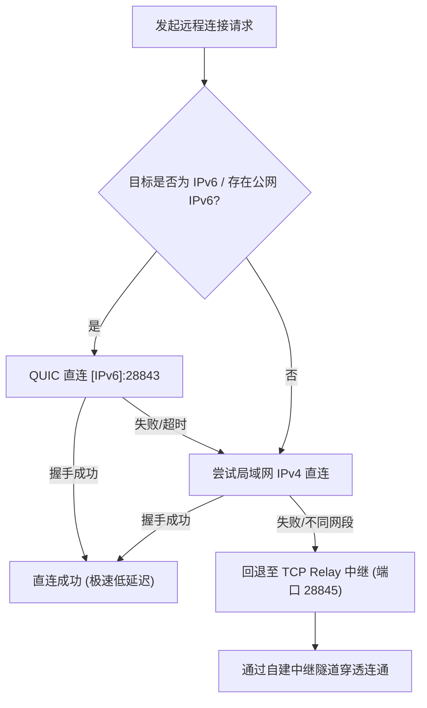

# OpenRemote 深度系统架构与设计规范

本文档面向开发者与架构师，深入阐述 OpenRemote 的内部运作机制、核心算法及网络协议规范。

---

## 1. 总体架构与数据流向

OpenRemote 采用现代轻量化分层架构，前后端通过 Tauri v2 的异步 IPC 通信，底层使用 Rust 编写高性能多线程引擎。

```
┌────────────────────────────────────────────────────────┐
│             UI 渲染层 (React 18 + Canvas)              │
│       - RemoteView (原生 Canvas 帧绘制 + 交互事件拦截)   │
│       - FileTransfer (双向文件流式上传 / 进度看板)       │
└───────────────────────────▲────────────────────────────┘
                            │ Tauri IPC (Commands / Events)
┌───────────────────────────▼────────────────────────────┐
│                  Rust 核心引擎控制中枢                 │
│                                                        │
│  ┌───────────────────────┐   ┌──────────────────────┐  │
│  │     ScreenCapture     │   │      InputEngine     │  │
│  │ DXGI Duplication 抓屏 │   │ Enigo 键鼠注入模拟   │  │
│  └───────────┬───────────┘   └──────────▲───────────┘  │
│              │ 原生 BGRA                │ KeyEvent /   │
│  ┌───────────▼───────────┐              │ MouseEvent   │
│  │     Dirty Detector    │              │              │
│  │   全局步长采样哈希过滤  │              │              │
│  └───────────┬───────────┘              │              │
│              │ 脏帧通过                 │              │
│  ┌───────────▼───────────┐   ┌──────────┴───────────┐  │
│  │      Image Encoder    │   │  FileTransferManager │  │
│  │  RGB8 紧凑编码 (JPEG) │   │ 64KB分块/SHA-256校验 │  │
│  └───────────┬───────────┘   └──────────▲───────────┘  │
└──────────────┼──────────────────────────┼──────────────┘
               │ ScreenFrame              │ FileChunk
┌──────────────▼──────────────────────────▼──────────────┐
│                  Bincode 二进制序列化层                 │
│         [ 4-byte Magic ] + [ 4-byte PayloadLen ]       │
└───────────────────────────┬────────────────────────────┘
                            │ Raw Bytes
┌───────────────────────────▼────────────────────────────┐
│                    自适应多协议传输层                   │
│  ┌──────────────────────────────────────────────────┐  │
│  │ 优先: QUIC (quinn) 双栈监听 [::]:28843           │  │
│  │       支持原生 IPv6 全球直连 / 局域网 IPv4 直连  │  │
│  ├──────────────────────────────────────────────────┤  │
│  │ 回退: TCP Relay (穿透隧道) 端口 28845            │  │
│  │       全双工 Session 字节流透明透传              │  │
│  └──────────────────────────────────────────────────┘  │
└────────────────────────────────────────────────────────┘
```

---

## 2. 屏幕捕获与优化管道 (Screen Pipeline)

### 2.1 DXGI Desktop Duplication 原生捕获
在 Windows 平台上，传统 GDI `BitBlt` 抓屏效率低且无法绕过硬件渲染加速窗口。OpenRemote 采用 Windows DirectX Graphics Infrastructure (DXGI) Output Duplication API：
- 从显存显卡帧缓冲区直接锁定桌面表面（Desktop Surface）；
- 捕获的帧数据以 `BGRA` 像素格式驻留，步长对齐硬件显存。

### 2.2 紧凑 RGB 转换与内存复用
为消除每次抓屏高达 14MB+ 的堆内存分配与数千万次 `Vec::push` 循环开销：
- 内部常驻可复用的 `rgb_buffer: Vec<u8>`；
- 单趟指针遍历：读取 `BGRA` 4 字节，原地写入 `RGB` 3 字节，剔除无用的 Alpha 透明通道，直接降低 25% 原始数据量。

### 2.3 快速采样脏帧抑制算法 (Dirty Detection)
为解决“桌面静止时持续编码发送造成 CPU 与带宽浪费”的痛点，OpenRemote 设计了步长采样检测机制：
```rust
// 脏帧检测核心思路：以固定步长采样子集，计算哈希差分
let sample_step = 64; // 均匀采样步长
let mut hasher = DefaultHasher::new();
for i in (0..rgb.len()).step_by(sample_step) {
    hasher.write_u8(rgb[i]);
}
let current_hash = hasher.finish();

if current_hash == last_hash {
    // 画面无显著变动，跳过编码和网络发送
    return Ok(None);
}
```
**实测指标**：桌面无操作时，服务端 CPU 占用降至 **< 0.5%**，网络带宽占用降为 **0 KB/s**。

---

## 3. 协议层治理 (Bincode Protocol)

### 3.1 淘汰 JSON 序列化
在老旧实现中，采用 `serde_json` 将二进制图片转为数组传输，会导致：
1. 网络传输包体积膨胀 3.5 ~ 4 倍；
2. 反序列化时对数万浮点/整型字符逐个词法解析，占用巨大 CPU 资源。

### 3.2 自定义网络封包格式
所有传输层（QUIC 与 TCP Relay）统一采用标准化二进制帧头：
```
+-------------------+---------------------+-------------------------------+
|  Magic (4 Bytes)  |  Length (4 Bytes)   |    Bincode Payload (N Bytes)  |
|    0x4F52454D     |  u32 Big-Endian     |     Serialized Message Enum   |
+-------------------+---------------------+-------------------------------+
```

- **Magic**: 固定为 `0x4F52454D` (`"OREM"`，OpenRemote 标识)；
- **Length**: 承载 Payload 的精确字节数，彻底防范网络粘包与截断；
- **Payload**: Rust 枚举结构体通过 `bincode::serialize` 紧凑编排。

---

## 4. 传输架构与公网打洞策略

OpenRemote 实行**分级连接策略**，保障在任意网络拓扑下均可连通：



1. **IPv6 零配置探测与优先直连**：
   - 客户端通过底层 UDP Socket 绑定系统单播地址，检测公网 IPv6（过滤以 `fe80::` 开头的链路本地地址及 `::1` 回环地址）；
   - 若双方存在 IPv6，优先通过 QUIC 双栈监听端口直连，无中继服务器带宽限制。
2. **TCP Relay 动态配对隧道**：
   - 被控端发起 `REGISTER <DeviceCode>` 注册中继会话；
   - 控制端发起 `JOIN <DeviceCode>` 接入对应会话；
   - 中继服务器在内存中将两个 TCP Stream 建立双向管道（全双工 `pipe`），实现端到端透明中继。

---

## 5. 文件传输完整性与流控

- **分块策略**：文件按固定 64KB 切片流式发送；
- **握手协议**：发送方在传输前发送 `FileTransferStart`，协商文件名、文件大小及 SHA-256 校验和；
- **落盘与校验**：接收方在 `Downloads/OpenRemote/` 路径自动创建或追加写入文件，并在尾帧比对哈希；如果校验通过，触发前端通知及打开目录事件。
